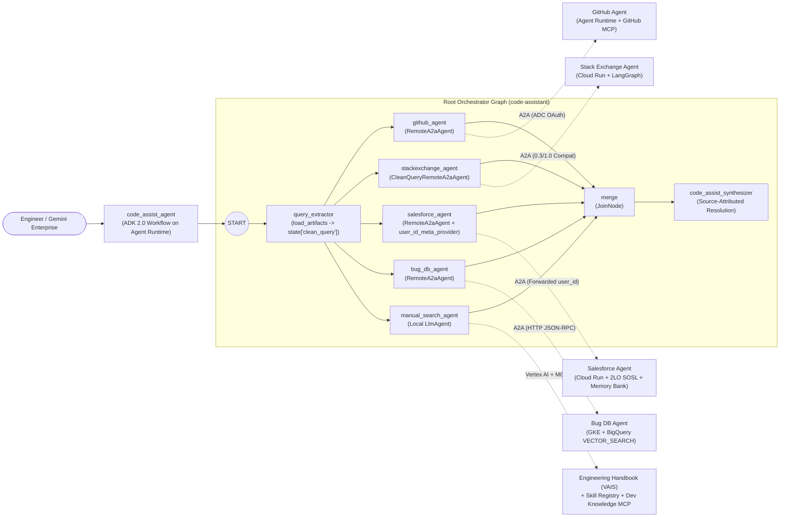

# FDE: Multi-Agent Code Assistant on Google Cloud (ADK 2.0 + A2A)

A distributed, production-grade multi-agent engineering incident resolution system built with **Google Cloud Agent Development Kit (ADK 2.0)**, **LangGraph**, **Model Context Protocol (MCP)**, **Vertex AI Search**, **GCP Skill Registry**, **BigQuery Vector Search**, **Vertex AI Memory Bank**, and the **Agent2Agent (A2A)** protocol, published to **Gemini Enterprise**.

---

## Documentation Suite

| Document | Purpose & Scope |
| :--- | :--- |
| [**Architectural Design (`docs/ARCHITECTURE.md`)**](docs/ARCHITECTURE.md) | Comprehensive architectural blueprint: ADK 2.0 `Workflow` graph (`START -> query_extractor -> 5 parallel specialists -> JoinNode -> synthesizer`), heterogeneous compute topology (Agent Runtime, Cloud Run, GKE), A2A protocol interoperability (`0.3` vs `1.0`, ADK executor extensions vs. deterministic LangGraph), multi-hop authentication (ADC OAuth, GitHub PAT, Salesforce 2LO Client Credentials), and cross-A2A user-scoped Vertex AI Memory Bank design. |
| [**Step-by-Step Lab Manual (`docs/LAB_MANUAL.md`)**](docs/LAB_MANUAL.md) | End-to-end hands-on engineering manual covering **Tasks 1 through 7** with exact file paths, Python implementations, environment configurations, IAM bindings, deployments, and verification commands. |
| [**Operational Runbook & Playbook (`docs/RUNBOOK_AND_PLAYBOOK.md`)**](docs/RUNBOOK_AND_PLAYBOOK.md) | Day-1 deployment runbooks, Day-2 operational health checks, smoke-test suites, evaluation workflows (`agents-cli eval`), and incident response playbooks (RCA & remediation for 401/403 A2A errors, A2A 0.3/1.0 schema mismatches, SOSL indexing lag, BigQuery vector search failures, and Memory Bank user-scoping issues). |

---

## System Topology at a Glance



---

## Repository Structure

```text
.
├── README.md                        # Project overview, topology, and quick navigation
├── .gitignore                       # Excludes .env secrets, virtualenvs, caches, and locks
├── docs/
│   ├── ARCHITECTURE.md              # Full architectural design & protocol specifications
│   ├── LAB_MANUAL.md                # Step-by-step lab manual (Tasks 1 through 7)
│   └── RUNBOOK_AND_PLAYBOOK.md      # Day-1/Day-2 runbook & incident response playbooks
├── code-assistant/                  # Root ADK 2.0 Workflow orchestrator (Vertex AI Agent Runtime)
│   ├── app/
│   │   ├── agent.py                 # Workflow DAG, RemoteA2aAgent wiring, SkillToolset, VAIS
│   │   ├── auth.py                  # GoogleADCAuth httpx client & Developer Knowledge MCP headers
│   │   ├── callbacks.py             # capture_response_to_state after_agent_callback
│   │   ├── skills/                  # using-developer-knowledge-mcp SKILL.md
│   │   └── app_utils/               # a2a.py (user_id_meta_provider), clean_query_a2a.py
│   └── scripts/publish_skill.py     # Publishes SKILL.md to Vertex AI Skill Registry
├── github-agent/                    # GitHub specialist (Vertex AI Agent Runtime + GitHub MCP)
│   └── app/agent.py                 # McpToolset with Bearer PAT & read-only tool_filter
├── stackexchange-agent/             # Stack Exchange specialist (Cloud Run / GKE + LangGraph + a2a-sdk 1.x)
│   └── app/
│       ├── agent.py                 # Single-node deterministic LangGraph StateGraph
│       ├── agent_executor.py        # StackExchangeExecutor bridging A2A 1.x to LangGraph
│       └── server.py                # Starlette ASGI server with dual 1.0/0.3 AgentInterface
├── bq-agent/                        # Bug Database specialist (GKE + BigQuery VECTOR_SEARCH)
│   └── app/
│       ├── agent.py                 # Grounded ADK agent citing BUG-XXXX identifiers
│       └── tools.py                 # text-embedding-004 + BigQuery COSINE VECTOR_SEARCH
└── salesforce-agent/                # Salesforce specialist (Cloud Run + 2LO OAuth + Memory Bank)
    ├── app/
    │   ├── agent.py                 # PreloadMemoryTool + generate_memories_callback
    │   ├── salesforce_client.py     # 2LO client_credentials + SOSL ContentVersion + excerpting
    │   ├── tools.py                 # Session token caching & 401 auto-reauthentication
    │   └── app_utils/               # _user_scoped_request_converter + VertexAiMemoryBankService
    └── scripts/create_memory_bank.py# Idempotent Vertex AI Memory Bank provisioning script
```

---

## Summary of Specialist Agents

| Agent | Framework | Compute Target | Backing Data / Tools | Auth Mechanism |
| :--- | :--- | :--- | :--- | :--- |
| **`code-assistant`** | ADK 2.0 `Workflow` | Vertex AI Agent Runtime | 4 Remote A2A Agents + Vertex AI Search + GCP Skill Registry + Developer Knowledge MCP | Runtime Service Account (`GoogleADCAuth`) |
| **`github-agent`** | ADK `Agent` | Vertex AI Agent Runtime | Hosted GitHub Copilot MCP (`search_repositories`, `search_issues`, `list_issues`) | Caller: GCP IAM (`roles/aiplatform.user`)<br/>Upstream: GitHub PAT (`Bearer`) |
| **`stackexchange-agent`** | LangGraph + `a2a-sdk` 1.x | Cloud Run (or GKE) | LangChain `StackExchangeTool` (StackAPI) | Public HTTP (`--allow-unauthenticated`) |
| **`bq-agent`** | ADK `Agent` | GKE Autopilot | Vertex AI `text-embedding-004` + BigQuery `VECTOR_SEARCH` (`code_assist_bugs.known_bugs`) | Workload Identity / ADC |
| **`salesforce-agent`** | ADK `Agent` | Cloud Run | Salesforce Files SOSL (`ContentVersion`) + Vertex AI Memory Bank | Upstream: 2LO `client_credentials`<br/>Memory: Forwarded `user_id` metadata |
