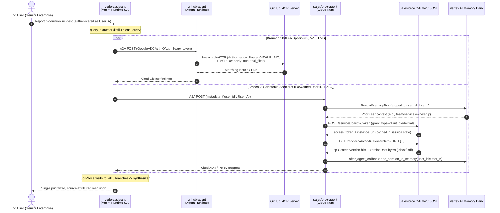
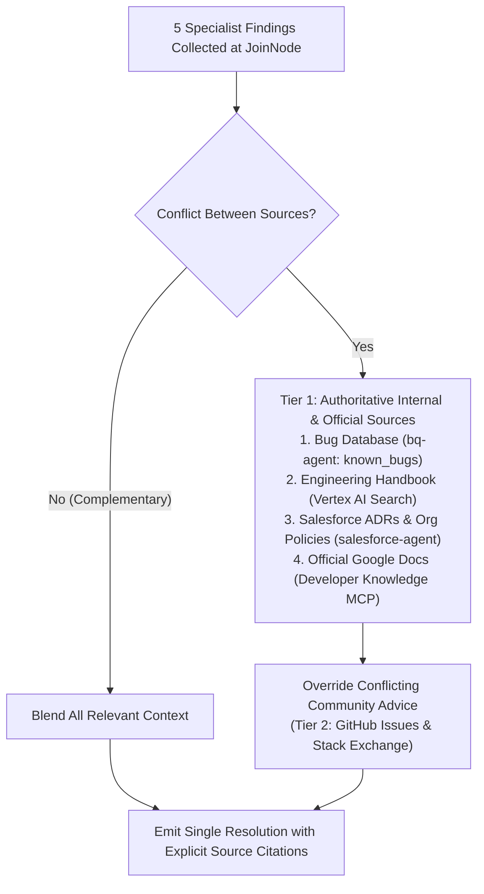

# Playbook Architectural Design: Multi-Agent Code Assistant (FDE)

## 1. Executive Summary & Architectural Vision

The **Code Assist (`code-assistant`)** platform is an enterprise-grade, distributed multi-agent system designed to resolve production software engineering incidents. When an engineer submits an exception, stack trace, or screenshot/log artifact via **Gemini Enterprise** (or ADK Playground/API), the system:

1. **Extracts & Distills (`query_extractor`)**: Parses text and uploaded artifacts (`load_artifacts`) into a concise, noise-free technical search query (`state["clean_query"]`).
2. **Fans Out in Parallel (5 Specialists)**: Queries five heterogeneous internal and external knowledge bases simultaneously across **Agent2Agent (A2A)** and **Model Context Protocol (MCP)** boundaries:
   - **Internal Bug Database (`bq-agent`)**: Semantic vector search over historical engineering incidents in BigQuery (`code_assist_bugs.known_bugs`).
   - **Internal Engineering Handbook & Official Google Docs (`manual_search_agent`)**: Hybrid retrieval combining internal team runbooks/standards in **Vertex AI Search** with official Google documentation via the **Developer Knowledge MCP** (guided dynamically by a skill fetched from the **GCP Skill Registry**).
   - **Cross-Team Architecture Decisions & Org Policies (`salesforce-agent`)**: Full-text SOSL search and document excerpt extraction across `.docx`/`.pdf` files in **Salesforce Files**, personalized with long-term user recall via **Vertex AI Memory Bank**.
   - **Source Control & Issue Tracker (`github-agent`)**: Live repository and issue search via the hosted **GitHub MCP Server**.
   - **Community Q&A (`stackexchange-agent`)**: Deterministic keyword search over Stack Overflow / Stack Exchange via a **LangGraph** graph served natively on **`a2a-sdk` 1.x**.
3. **Synchronizes (`JoinNode`) & Synthesizes (`code_assist_synthesizer`)**: Waits for all five branches to complete, collects their state keys, and synthesizes a single, conflict-resolved, source-attributed remediation plan that prioritizes authoritative internal sources and official documentation over community answers.

---

## 2. End-to-End System Architecture

### 2.1 High-Level Component & Deployment Topology

```mermaid
flowchart TB
    subgraph ClientLayer ["Presentation & Enterprise Layer"]
        GE["Gemini Enterprise App<br/>(engines/enterprise-app)"]
        CLI["agents-cli / ADK Playground"]
    end

    subgraph RootRuntime ["Vertex AI Agent Runtime (us-central1)"]
        subgraph RootWorkflow ["code-assistant (ADK 2.0 Graph Workflow)"]
            START(("START")) --> QE["1. query_extractor<br/>(Gemini 3.5 Flash + load_artifacts)"]
            QE -->|"state['clean_query']"| GH_Client["github_agent<br/>(RemoteA2aAgent)"]
            QE -->|"state['clean_query']"| SE_Client["stackexchange_agent<br/>(CleanQueryRemoteA2aAgent)"]
            QE -->|"state['clean_query']"| SF_Client["salesforce_agent<br/>(RemoteA2aAgent + user_id_meta_provider)"]
            QE -->|"state['clean_query']"| BQ_Client["bug_db_agent<br/>(RemoteA2aAgent)"]
            QE -->|"state['clean_query']"| MS_Node["manual_search_agent<br/>(Local LlmAgent)"]

            GH_Client -->|"state['github_findings']"| JOIN["merge<br/>(JoinNode)"]
            SE_Client -->|"state['stackexchange_findings']"| JOIN
            SF_Client -->|"state['salesforce_findings']"| JOIN
            BQ_Client -->|"state['bug_findings']"| JOIN
            MS_Node -->|"state['manual_findings']"| JOIN

            JOIN --> SYNTH["code_assist_synthesizer<br/>(Conflict Resolution & Citation)"]
        end
    end

    subgraph RemoteSpecialists ["Distributed Specialist Fleet (A2A Protocol)"]
        direction LR
        subgraph AgentRuntimeSub ["Vertex AI Agent Runtime"]
            GH_Svc["github-agent<br/>(ADK + McpToolset)"]
        end
        subgraph CloudRunSub ["Google Cloud Run (Serverless)"]
            SE_Svc["stackexchange-agent<br/>(LangGraph + a2a-sdk 1.x)"]
            SF_Svc["salesforce-agent<br/>(ADK + 2LO Client + Memory)"]
        end
        subgraph GKESub ["GKE Autopilot Cluster"]
            BQ_Svc["bq-agent<br/>(ADK + BigQuery Vector Search)"]
        end
    end

    subgraph BackingServices ["Enterprise Data, Knowledge & Memory Plane"]
        GH_MCP["GitHub Copilot MCP Server<br/>(api.githubcopilot.com/mcp)"]
        SE_API["Stack Exchange API<br/>(StackAPI)"]
        SF_API["Salesforce REST & SOSL API<br/>(ContentVersion Files)"]
        V_MEM["Vertex AI Memory Bank<br/>(Regional: us-central1)"]
        BQ_DB[("BigQuery Table<br/>code_assist_bugs.known_bugs")]
        V_EMB["Vertex AI Embeddings<br/>(text-embedding-004)"]
        VAIS[("Vertex AI Search Datastore<br/>code-manuals-datastore")]
        SKILL_REG["GCP Skill Registry<br/>(using-developer-knowledge-mcp)"]
        DK_MCP["Developer Knowledge MCP<br/>(developerknowledge.googleapis.com/mcp)"]
    end

    GE --> RootWorkflow
    CLI --> RootWorkflow

    GH_Client ==>|"HTTPS A2A + GoogleADCAuth"| GH_Svc
    SE_Client ==>|"HTTPS A2A (v0.3/v1.0 Compat)"| SE_Svc
    SF_Client ==>|"HTTPS A2A + metadata.user_id"| SF_Svc
    BQ_Client ==>|"HTTP A2A (:8080/a2a/app)"| BQ_Svc

    GH_Svc -->|"Bearer PAT (Read-Only)"| GH_MCP
    SE_Svc -->|"REST"| SE_API
    SF_Svc -->|"2LO OAuth + SOSL"| SF_API
    SF_Svc <-->|"PreloadMemory / add_session_to_memory"| V_MEM
    BQ_Svc -->|"Embed Query"| V_EMB
    BQ_Svc -->|"COSINE VECTOR_SEARCH"| BQ_DB
    MS_Node -->|"Internal Handbook"| VAIS
    MS_Node -->|"1. search_skills / load_skill"| SKILL_REG
    MS_Node -->|"2. search_documents / get_documents"| DK_MCP
```



---

## 3. Core Architectural Patterns & Design Decisions

### 3.1 ADK 2.0 Graph `Workflow` Fan-Out / Fan-In Orchestration

Unlike a traditional sequential ReAct loop where a single LLM calls tools one turn at a time (accumulating latency and context-window bloat), `code-assistant` uses the declarative **ADK 2.0 `Workflow` graph API** (`google.adk.workflow.Workflow` and `JoinNode`):

```python
specialists = [
    github_agent,
    stackexchange_agent,
    salesforce_agent,
    bug_db_agent,
    manual_search_agent,
]

root_agent = Workflow(
    name="code_assist_agent",
    edges=[
        (START, query_extractor),
        # Fan out: query_extractor -> all 5 specialists concurrently
        *[(query_extractor, specialist) for specialist in specialists],
        # Fan in: all 5 specialists -> merge (JoinNode barrier)
        *[(specialist, merge) for specialist in specialists],
        # Final step: merge -> synthesizer
        (merge, synthesizer),
    ],
)
```

#### Why `capture_response_to_state` is Required for Remote A2A Nodes
A local `Agent` (`LlmAgent`) supports `output_key="manual_findings"`, which automatically writes its final response to `session.state["manual_findings"]`. However, `RemoteA2aAgent` is a `BaseAgent` subclass (not an `LlmAgent`) and does **not** have an `output_key` parameter, nor does `JoinNode` automatically aggregate branch outputs.

To bridge remote A2A responses into the shared session state for the downstream `synthesizer` prompt template (`{github_findings?}`, `{salesforce_findings?}`, etc.), `code-assistant/app/callbacks.py` implements a factory `capture_response_to_state(state_key)`:

```python
def capture_response_to_state(state_key: str) -> Callable:
    async def _after_agent_callback(callback_context: CallbackContext):
        name = callback_context.agent_name
        for event in reversed(callback_context.session.events):
            if event.author == name and event.content and event.content.parts:
                text = "\n".join(p.text for p in event.content.parts if p.text)
                if text:
                    callback_context.state[state_key] = text
                    break
        return None
    return _after_agent_callback
```

### 3.2 A2A Protocol Interoperability: Bridging `0.3.x` and `1.0.x`

A key architectural challenge in multi-team agent ecosystems is **protocol version skew** and **framework heterogeneity**:

| Aspect | ADK Sub-Agents (`github`, `salesforce`, `bq`) | Non-ADK Specialist (`stackexchange-agent`) |
| :--- | :--- | :--- |
| **Agent Framework** | Google ADK (`google-adk`) | LangGraph (`StateGraph`) |
| **A2A Server SDK** | `a2a-sdk` `0.3.x` (via `A2AFastAPIApplication`) | `a2a-sdk` `1.x` (Starlette custom routes) |
| **Client Mode in Root** | `RemoteA2aAgent(..., use_legacy=False)` | `CleanQueryRemoteA2aAgent` (`use_legacy` omitted / default) |
| **Payload Expectations** | Understands full conversational context + ADK metadata | Deterministic keyword search (`StackExchangeTool`); fails if sent conversational wrapper prose |

To make `stackexchange-agent` (`a2a-sdk` 1.x) seamlessly consumable by the root orchestrator (`a2a-sdk` 0.3.x), two architectural bridges are used:

1. **Server-Side Dual-Interface Advertisement (`stackexchange-agent/app/server.py`)**:
   - In `a2a-sdk` 1.x, `AgentCard` moved the endpoint URL into `supported_interfaces`. A `0.3.x` client expects a top-level `url` and `preferredTransport` field on the JSON card.
   - By advertising **both** `protocol_version="1.0"` and `protocol_version="0.3"` in `supported_interfaces` and passing `enable_v0_3_compat=True` to `create_jsonrpc_routes()`, `a2a-sdk` 1.x automatically emits the legacy top-level fields on `/.well-known/agent-card.json` and accepts legacy `0.3` JSON-RPC `message/send` requests.
2. **Client-Side Clean Query Extraction (`code-assistant/app/app_utils/clean_query_a2a.py`)**:
   - Default `RemoteA2aAgent._construct_message_parts_from_session()` serializes the entire session transcript (`"For context: [query_extractor] said: ..."`).
   - While LLM-backed specialists easily parse that wrapper, `stackexchange-agent` has **no LLM**—it passes the incoming string directly to the Stack Exchange search API.
   - `CleanQueryRemoteA2aAgent` overrides `_construct_message_parts_from_session` to send **only** `ctx.session.state["clean_query"]`.

### 3.3 On-Demand Skill Discovery via GCP Skill Registry + MCP

Rather than hardcoding complex tool-driving instructions for every external MCP server into the root prompt (which wastes tokens on unrelated queries), `manual_search_agent` combines:
- **`GCPSkillRegistry` + `SkillToolset`**: Connects to Vertex AI Skill Registry (`projects/{project}/locations/{location}/skills/using-developer-knowledge-mcp`).
- **`McpToolset` (`developer_knowledge_mcp`)**: Connects to `https://developerknowledge.googleapis.com/mcp`.

When `manual_search_agent` encounters a Google Cloud / ADK / Firebase / Android error:
1. It calls `search_skills` and `load_skill("using-developer-knowledge-mcp")`.
2. It reads the loaded `SKILL.md` instructions (which teach it how to chain `search_documents` -> deduplicate `parent` URIs -> batch `get_documents`, and how to detect out-of-corpus results).
3. It executes the grounded search and merges those findings with the internal **Vertex AI Search** (`code-manuals-datastore`) engineering handbook results.

### 3.4 Multi-Hop Authentication & Security Architecture



#### Key Security Controls
1. **Ambient ADC Authentication (`GoogleADCAuth`)**:
   - `code-assistant/app/auth.py` implements an `httpx.Auth` subclass wrapping `google.auth.default()`.
   - Locally, it uses developer ADC (`gcloud auth application-default login`); on Vertex AI Agent Runtime, it transparently uses the Agent Engine service account (`service-<PROJECT_NUMBER>@gcp-sa-aiplatform-re.iam.gserviceaccount.com`) with `roles/aiplatform.user` and `roles/discoveryengine.viewer`.
2. **Principle of Least Privilege on GitHub MCP**:
   - `github-agent` enforces defense-in-depth on the GitHub MCP connection via both HTTP header (`"X-MCP-Readonly": "true"`) and ADK client-side filtering (`tool_filter=["search_repositories", "search_issues", "list_issues"]`), preventing any write/mutation tool from being exposed to the model.
3. **2-Legged OAuth (Client Credentials) with Session Caching & 401 Retry on Salesforce**:
   - `salesforce-agent` authenticates as an application (`grant_type="client_credentials"`) with no interactive user consent flow required.
   - Because Salesforce omits `expires_in` on client-credentials tokens, `app/tools.py` caches the token in `tool_context.state["salesforce_app_token"]` with a conservative 3600s TTL (minus 60s skew) and automatically re-authenticates once if an API call returns HTTP `401`.

### 3.5 Cross-A2A User-Scoped Long-Term Memory (`VertexAiMemoryBankService`)

By default, an A2A server assigns each incoming conversation a synthetic user ID (`A2A_USER_<context_id>`). Because `<context_id>` changes on every new conversation, long-term memory stored under that ID can never be recalled in future sessions!

To enable true per-user long-term memory across A2A boundaries:
1. **Egress (`code-assistant/app/app_utils/a2a.py`)**:
   - `user_id_meta_provider(ctx, a2a_message)` extracts the real end-user identity (`ctx.user_id`) and attaches `{"user_id": ctx.user_id}` to the outgoing A2A request metadata on `salesforce_agent`.
2. **Ingress (`salesforce-agent/app/app_utils/a2a.py`)**:
   - `_user_scoped_request_converter` intercepts the incoming A2A request, reads `request.metadata.get("user_id")`, and overrides `run_request.user_id = forwarded_user_id`.
3. **Memory Persistence & Retrieval (`salesforce-agent/app/agent.py`)**:
   - **Read Path**: `PreloadMemoryTool()` automatically queries Vertex AI Memory Bank (`MEMORY_BANK_ID`) at the start of each turn for memories matching `{user_id, app_name}`.
   - **Write Path**: `generate_memories_callback` (`after_agent_callback`) awaits `callback_context.add_session_to_memory()`, asynchronously extracting and persisting durable user facts (such as the user's team, service ownership, or recurring architectural context) into Vertex AI Memory Bank.

---

## 4. Source Prioritization & Conflict Resolution Model

The terminal `code_assist_synthesizer` node enforces a strict epistemic hierarchy when synthesizing findings from the 5 branches:



Every claim in the final synthesized response must explicitly cite its origin (`Bug Database`, `Engineering Handbook`, `Official Google Docs`, `Salesforce`, `GitHub`, or `Stack Exchange`), ensuring engineers can immediately verify whether a recommended fix comes from an internal mandate (e.g., `ADR-007` or `BUG-1001`) or community discussion.
