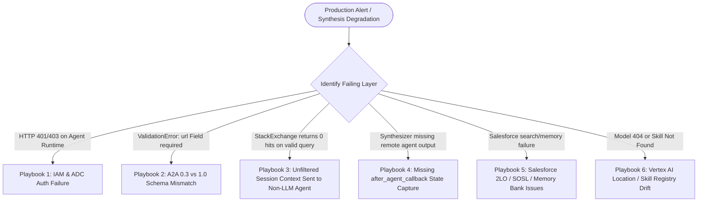

# Operational Runbook & Incident Response Playbook (FDE)

This document serves two operational roles for the **Multi-Agent Code Assistant (`code-assistant`)** fleet:
1. **Part I — Operational Runbook**: Standardized, repeatable procedures for pre-flight verification, unit/integration testing, health checks across Agent Runtime / Cloud Run / GKE, evaluation (`agents-cli eval`), and zero-downtime redeployments.
2. **Part II — Incident Response Playbook**: Symptom-driven diagnostic trees, Root Cause Analysis (RCA), and exact remediation commands for production failure modes.

---

## Part I: Operational Runbook

### 1. Pre-Flight Environment & Credential Verification

Run this checklist before executing deployments or debugging live agents:

```bash
# 1. Verify active GCP Project and Region
export PROJECT_ID=$(gcloud config get-value project)
export PROJECT_NUMBER=$(gcloud projects describe ${PROJECT_ID} --format='value(projectNumber)')
export REGION=us-central1
echo "Project: ${PROJECT_ID} (${PROJECT_NUMBER}) | Region: ${REGION}"

# 2. Verify gcloud & ADC credentials
gcloud auth list
gcloud auth application-default print-access-token >/dev/null && echo "ADC Token OK"

# 3. Verify agents-cli & uv installation
export PATH="${HOME}/.local/bin:${PATH}"
uv --version
agents-cli info
```

---

### 2. Fleet-Wide Unit Test Execution Runbook

Before deploying any changes, run the offline unit test suite across all 5 agent repositories to verify graph wiring, A2A 0.3/1.0 card compatibility, callback state capture, user-scoped A2A metadata, and tool mocks:

```bash
for agent in github-agent stackexchange-agent bq-agent salesforce-agent code-assistant; do
  echo "=== Testing ${agent} ==="
  (cd ~/agents/${agent} && uv run pytest tests/unit)
done
```

Expected result across the fleet:
- `github-agent`: 6 passed
- `stackexchange-agent`: 8 passed
- `bq-agent`: 12 passed
- `salesforce-agent`: 24 passed
- `code-assistant`: 13 passed

---

### 3. Live Fleet Health & A2A Agent-Card Smoke Tests

Every specialist in the fleet exposes a well-known A2A Agent Card (`/.well-known/agent-card.json`). Use the commands below to verify reachability and protocol readiness for each tier:

#### 3.1 `github-agent` (Vertex AI Agent Runtime — IAM Authenticated)
```bash
curl -sS -f -H "Authorization: Bearer $(gcloud auth print-access-token)" \
  "${GITHUB_AGENT_URL}" | python3 -m json.tool | head -n 25
```
*Health Criteria*: Returns HTTP 200 JSON with `"name": "github_agent"` and skills matching `search_repositories`, `search_issues`, `list_issues`.

#### 3.2 `stackexchange-agent` (Cloud Run — Public, Dual A2A 1.0/0.3)
```bash
curl -sS -f "${STACKEXCHANGE_AGENT_URL}" | python3 -m json.tool
```
*Health Criteria*: Returns HTTP 200 JSON containing **both** `"supportedInterfaces"` (`1.0` and `0.3`) **and** top-level `"url"` / `"preferredTransport": "JSONRPC"` fields.

#### 3.3 `salesforce-agent` (Cloud Run — 2LO OAuth + Memory Bank)
```bash
curl -sS -f "${SALESFORCE_AGENT_URL}" | python3 -m json.tool | head -n 25
```
*Health Criteria*: Returns HTTP 200 JSON with `"name": "salesforce_agent"` and skill `search_salesforce`.

#### 3.4 `bq-agent` (GKE Autopilot — BigQuery Vector Search)
```bash
curl -sS -f "${BQ_AGENT_URL}" | python3 -m json.tool | head -n 25
```
*Health Criteria*: Returns HTTP 200 JSON with `"name": "bq_agent"` and skill `find_similar_bugs`.

---

### 4. End-to-End Functional & Quality Evaluation Runbook (`agents-cli eval`)

To evaluate agent quality systematically using the built-in LLM-as-judge (`custom_response_quality` on a 1–5 rubric) and `agent_turn_count` metrics:

```bash
cd ~/agents/code-assistant

# 1. Run evaluation suite over datasets
agents-cli eval run

# 2. Cluster failure modes from grade results
agents-cli eval analyze

# 3. Compare two evaluation runs for regressions
agents-cli eval compare <baseline_results.json> <candidate_results.json>
```

---

### 5. Standard Redeployment Runbook (Rolling Updates)

| Component | Redeployment Procedure |
| :--- | :--- |
| **`github-agent`** or **`code-assistant`** (Agent Runtime) | `cd ~/agents/<agent> && rm -rf .venv && agents-cli deploy --project ${PROJECT_ID} --no-confirm-project --no-wait --update-env-vars "$(grep -v '^#' .env | grep -v '^$' | grep -v '^GOOGLE_CLOUD_PROJECT' | paste -sd,)"` followed by `agents-cli deploy --status` |
| **`salesforce-agent`** (Cloud Run via `agents-cli`) | `cd ~/agents/salesforce-agent && agents-cli deploy --project ${PROJECT_ID} --region ${REGION} --no-confirm-project --update-env-vars "$(grep -v '^#' .env | grep -v '^$' | grep -v '^GOOGLE_CLOUD_PROJECT' | paste -sd,)"` |
| **`stackexchange-agent`** (Cloud Run via Cloud Build) | `cd ~/agents/stackexchange-agent && gcloud builds submit --tag ${REGION}-docker.pkg.dev/${PROJECT_ID}/agents/stackexchange-agent:latest && gcloud run deploy stackexchange-agent --image ${REGION}-docker.pkg.dev/${PROJECT_ID}/agents/stackexchange-agent:latest --region ${REGION} --allow-unauthenticated --port 8080` |
| **`bq-agent`** (GKE Autopilot) | `cd ~/agents/bq-agent && agents-cli deploy` (or `kubectl rollout restart deployment/bq-agent`) |

> [!IMPORTANT]
> Whenever a specialist's URL changes (for example, deploying a new Reasoning Engine ID or Cloud Run service URL), you **must** update the corresponding `*_AGENT_URL` in `~/agents/code-assistant/.env` and redeploy `code-assistant` so the Agent Runtime environment variables are updated.

---

## Part II: Incident Response Playbook



---

### Playbook 1: HTTP `401 UNAUTHENTICATED` or `403 PERMISSION_DENIED` Calling `github-agent` or `Vertex AI Search`

- **Symptoms**:
  - `code-assistant` logs show `403 PERMISSION_DENIED` when resolving `GITHUB_AGENT_URL` (`/.well-known/agent-card.json`) or querying `code-manuals-datastore`.
  - Direct `curl` to `GITHUB_AGENT_URL` returns `401 UNAUTHENTICATED (CREDENTIALS_MISSING)`.
- **Root Cause**:
  1. Vertex AI Agent Runtime endpoints require Google OAuth2 Bearer tokens (`GoogleADCAuth`). If `httpx_client=google_authed_client()` is missing on `RemoteA2aAgent`, requests are sent unauthenticated (`401`).
  2. If authenticated, the root Agent Runtime service account (`service-<PROJECT_NUMBER>@gcp-sa-aiplatform-re.iam.gserviceaccount.com`) lacks `roles/aiplatform.user` or `roles/discoveryengine.viewer` (`403`).
- **Remediation**:
  1. Verify `httpx_client=google_authed_client()` is passed to `github_agent` in `code-assistant/app/agent.py`.
  2. Bind the required IAM roles to the Reasoning Engine Service Agent:
     ```bash
     export PROJECT_NUMBER=$(gcloud projects describe ${PROJECT_ID} --format='value(projectNumber)')
     gcloud projects add-iam-policy-binding ${PROJECT_ID} \
       --member="serviceAccount:service-${PROJECT_NUMBER}@gcp-sa-aiplatform-re.iam.gserviceaccount.com" \
       --role="roles/aiplatform.user"
     gcloud projects add-iam-policy-binding ${PROJECT_ID} \
       --member="serviceAccount:service-${PROJECT_NUMBER}@gcp-sa-aiplatform-re.iam.gserviceaccount.com" \
       --role="roles/discoveryengine.viewer"
     ```

---

### Playbook 2: `ValidationError: url Field required` When Connecting to `stackexchange-agent`

- **Symptoms**:
  - `code-assistant` fails to parse the agent card from `STACKEXCHANGE_AGENT_URL` with `pydantic.ValidationError: url Field required`, or receives `Connection refused` to `http://localhost:8080/a2a/jsonrpc`.
- **Root Cause**:
  1. `google-adk` uses `a2a-sdk` `0.3.x`, which requires top-level `url` and `preferredTransport` fields in `/.well-known/agent-card.json`. `a2a-sdk` `1.x` omits those fields unless a `0.3` `AgentInterface` is included in `supported_interfaces`.
  2. Alternatively, `PUBLIC_URL` was not set on the Cloud Run / GKE service after deployment, so the card advertises `http://localhost:8080/a2a/jsonrpc`.
- **Remediation**:
  1. Verify `supported_interfaces` in `stackexchange-agent/app/server.py` includes both `protocol_version="1.0"` and `protocol_version="0.3"`, and `create_jsonrpc_routes` sets `enable_v0_3_compat=True`.
  2. Update `PUBLIC_URL` on Cloud Run to match the external service URL:
     ```bash
     export SE_URL=$(gcloud run services describe stackexchange-agent --region ${REGION} --format='value(status.url)')
     gcloud run services update stackexchange-agent --region ${REGION} --set-env-vars PUBLIC_URL=${SE_URL}
     ```

---

### Playbook 3: `stackexchange-agent` Returns Empty or Irrelevant Results in Workflow Runs

- **Symptoms**:
  - Calling `stackexchange-agent` directly works, but when invoked from `code-assistant`, Stack Exchange returns no relevant answers.
- **Root Cause**:
  - Standard `RemoteA2aAgent` constructs outgoing messages from the entire session history (`"For context: [query_extractor] said: ..."`). Because `stackexchange-agent` is a deterministic LangGraph node without an LLM, it passes that entire conversational blob directly to the Stack Exchange API.
- **Remediation**:
  - Ensure `stackexchange_agent` in `code-assistant/app/agent.py` is instantiated with `CleanQueryRemoteA2aAgent` (from `app.app_utils.clean_query_a2a`), which sends only `state["clean_query"]`.

---

### Playbook 4: Specialist Executes Successfully, But `code_assist_synthesizer` Ignores Its Findings

- **Symptoms**:
  - Cloud Trace / logs confirm a remote A2A specialist returned a valid answer, yet the synthesizer acts as though that source returned nothing.
- **Root Cause**:
  - `RemoteA2aAgent` does not have an `output_key` attribute, and `JoinNode` does not copy remote agent event text into session state. Without `after_agent_callback=capture_response_to_state("<key>_findings")`, `session.state["<key>_findings"]` remains unset.
- **Remediation**:
  - Verify every `RemoteA2aAgent` in `code-assistant/app/agent.py` has `after_agent_callback=capture_response_to_state(...)` matching the exact placeholder name in `synthesizer.instruction` (`{github_findings?}`, `{stackexchange_findings?}`, `{salesforce_findings?}`, `{bug_findings?}`).

---

### Playbook 5: Salesforce Specialist Auth Failure, Missing Documents, or Cross-Session Amnesia

- **Symptoms & Resolutions**:
  1. **`400 Bad Request` / `invalid_client` or `unsupported_grant_type` on Salesforce Auth**:
     - Verify `SALESFORCE_DOMAIN` has no `https://` prefix or trailing slash Issues (handled by `SalesforceClient`), `SALESFORCE_CLIENT_ID` and `SALESFORCE_CLIENT_SECRET` match the Connected App / External Client App, and **Enable Client Credentials Flow** has a valid **Run-As User** assigned in Salesforce Setup.
  2. **Uploaded `.docx` / `.pdf` ADR Files Not Returned by `search_salesforce`**:
     - Salesforce SOSL full-text indexing of `ContentVersion` lags **~15 minutes** after file upload. Verify file presence immediately via SOQL (`SELECT COUNT() FROM ContentVersion`) and ensure the Run-As user has **Query All Files** / **View All Data** permission.
  3. **Memory Bank Does Not Recall User Facts Across Separate Conversations**:
     - Verify `MEMORY_BANK_ID` is set in `salesforce-agent/.env` and `MEMORY_BANK_LOCATION=us-central1` (Memory Bank is regional; `global` returns `404`).
     - Verify `a2a_request_meta_provider=user_id_meta_provider` is configured on `salesforce_agent` in `code-assistant/app/agent.py` and `_user_scoped_request_converter` is active in `salesforce-agent/app/app_utils/a2a.py` so memories are keyed by the real `user_id` rather than ephemeral `A2A_USER_<context_id>`.

---

### Playbook 6: `404 NOT_FOUND` on Gemini Model Calls or Skill Registry Lookups

- **Symptoms**:
  - Agent fails with `404 NOT_FOUND` when invoking `gemini-3.5-flash`, or `manual_search_agent` cannot find `using-developer-knowledge-mcp`.
- **Root Cause**:
  1. `gemini-3.5-flash` is served from the `global` Vertex AI endpoint (`GOOGLE_CLOUD_LOCATION=global`), whereas regional services like Skill Registry (`SKILL_REGISTRY_LOCATION=us-central1`), Embeddings (`EMBEDDING_LOCATION=us-central1`), and Memory Bank (`MEMORY_BANK_LOCATION=us-central1`) require regional endpoints.
  2. Updating an existing skill in GCP Skill Registry in-place does not refresh its semantic search index.
- **Remediation**:
  1. Keep `GOOGLE_CLOUD_LOCATION=global` in `.env` while keeping `SKILL_REGISTRY_LOCATION=us-central1`, `EMBEDDING_LOCATION=us-central1`, and `MEMORY_BANK_LOCATION=us-central1`.
  2. Ensure `scripts/publish_skill.py` has been executed for `${PROJECT_ID}` in `us-central1`.
